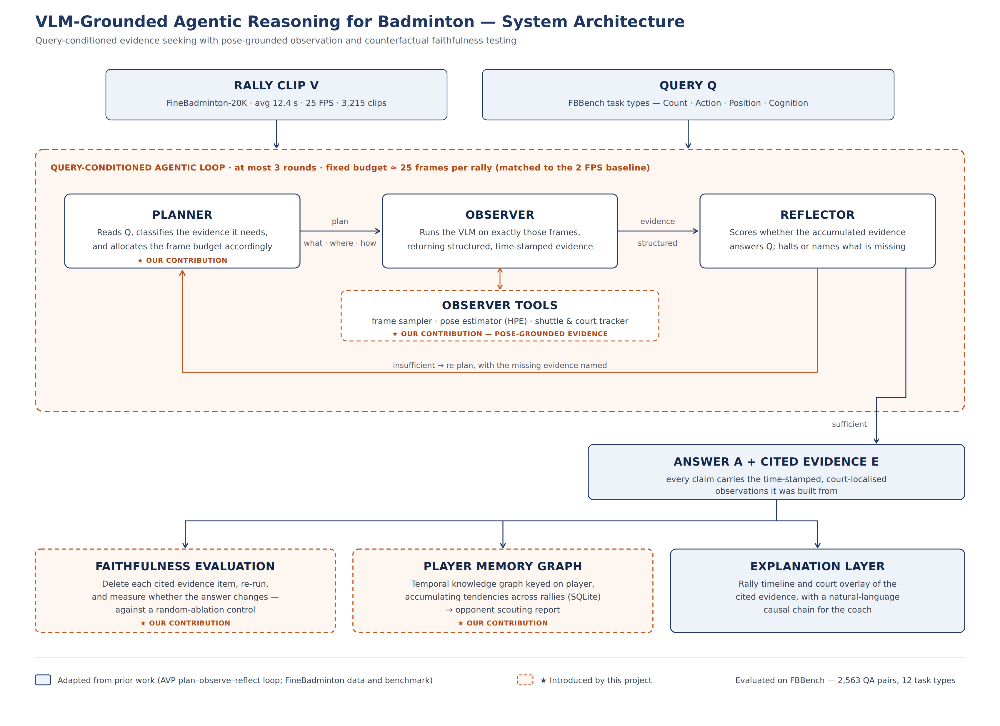

# VLM-Grounded Agentic Reasoning for Badminton

Query-conditioned agentic evidence seeking with pose-grounded observation and
counterfactual faithfulness testing, evaluated on **FBBench** (FineBadminton, ACM MM 2025).

Final-year BTP · Indian Institute of Information Technology Kottayam

| | |
|---|---|
| **Team** | Amal V Pratish (2023BCS0004) · Gourilakshmi S (2023BCS0021) · Mohammed Sabeeh K (2023BCS0108) · Jaladi Keerthi Vishaal (2023BCS0022) |
| **Guide** | Dr Jeena Thomas |
| **Dataset** | [FineBadminton-20K](https://huggingface.co/datasets/Moujuruo/Finebadminton-20K) · [FBBench](https://huggingface.co/datasets/Moujuruo/FineBadmintonBenchmark) (Apache-2.0) |
| **Hardware** | 1 × NVIDIA A100 |



## What this is

FineBadminton's baseline selects keyframes with a **trained but query-agnostic** module:
the same visual tokens are produced whether the question is a counting task or a
causal-reasoning one. FBBench spans 12 task types whose evidence requirements are
contradictory, so no single allocation can serve all of them.

We replace fixed selection with a **planner that allocates the same frame budget per
query type**, and we test whether the evidence the system cites is what actually drove
its answer.

See [`docs/NOVELTY.md`](docs/NOVELTY.md) for the full contribution statement and
[`docs/ROADMAP.md`](docs/ROADMAP.md) for the phase plan.

## Quick start

```bash
git clone <this-repo> && cd badminton-agentic-vlm
python -m venv .venv && source .venv/bin/activate
pip install -r requirements.txt

# 1. Download the data (Apache-2.0, no request form)
hf download Moujuruo/Finebadminton-20K       --repo-type dataset --local-dir data/finebadminton-20k
hf download Moujuruo/FineBadmintonBenchmark  --repo-type dataset --local-dir data/fbbench

# 2. Verify splits and check for train/test contamination  <-- DO THIS FIRST
python scripts/00_verify_dataset.py

# 3. Zero-shot benchmark under uniform 2 FPS sampling
python scripts/01_zeroshot_benchmark.py --model qwen2_5_vl_7b --limit 200
```

## Evaluation discipline

**FBBench is touched only for final numbers.** All development, prompt iteration and
LoRA training happen on FineBadminton-20K. Tuning against the benchmark inflates the
numbers and invalidates the comparison to published results.

Reference points from the FineBadminton paper:

| System | Overall MCQ accuracy |
|---|---|
| 7B open-source, zero-shot | < 25% |
| Gemini 2.5 Pro + their sampling | 38.6% |
| Qwen2.5-VL-7B + their full pipeline, fine-tuned | **42.06%** |

The frame budget to match is **uniform 2 FPS** — about 25 frames over a 12.4 s rally.
Our claim is *given the same frames, we choose better ones*, never *we use more frames*.

## Layout

```
configs/      experiment and model configs (YAML)
docs/         novelty statement, roadmap, architecture diagram
scripts/      numbered entry points, run in order
src/bavlm/
  data/       dataset loading, annotation schema, split verification
  sampling/   uniform baseline, reproduced hit-centric baseline
  agent/      planner / observer / reflector and the loop
  tools/      pose estimation, shuttle and court tracking
  memory/     temporal knowledge graph (SQLite)
  eval/       FBBench scoring, counterfactual faithfulness
results/      run outputs (git-ignored except the manifest)
```

## Branch and commit convention

- `main` — always runnable
- `phase/<n>-<slug>` — one branch per roadmap phase
- Commits: `<area>: <what changed>` e.g. `sampling: add hit-centric anchor detection`

## License

Code MIT (see `LICENSE`). FineBadminton data is Apache-2.0 and is **not** redistributed
here — download it yourself with the commands above.
